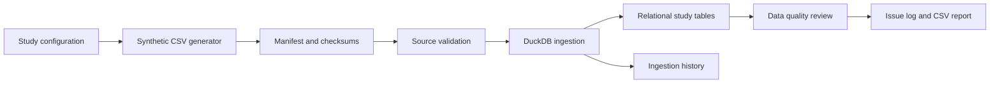

# Clinical Trial Data Quality & Validation Platform

A local Python data platform for a synthetic multisite clinical study. It generates reproducible records, loads them into DuckDB with source tracking, and reviews them against configurable study-data quality rules.

The project focuses on reliable data ingestion and traceable detection of inconsistent study records.

## What it does

- Generates a fictional 12-week study with four sites, 500 participants and four scheduled visits per participant by default.
- Produces six related CSV datasets: sites, participants, visits, vital signs, laboratory results and adverse events.
- Records file checksums and row counts in a SHA-256 manifest so a generated dataset can be verified before loading.
- Checks required columns, identifiers, data types, date formats and cross-table references.
- Loads records into DuckDB with explicit types, primary/foreign keys and all-or-nothing transactions.
- Tracks imported source files and reports successful, skipped and failed imports.
- Prevents duplicate ingestion of an identical source manifest, while allowing different generated datasets to coexist.
- Reviews expected visits, measurement completeness, dates, codes, units, synthetic review ranges and adverse-event chronology without changing source records.
- Stores issue IDs, severity, affected-record references and evaluation history; exports a CSV issue report.

## Data flow



The input data is synthetic. Study groups, measurements and adverse events are simulated; they are not records from a clinical trial.

## Getting started

**Requirements:** Python 3.11+ and Git. The application runs locally on Windows, Linux or macOS. DuckDB is installed as a Python dependency; no database server or cloud account is needed.

From the project root, on Windows using **Git Bash**:

```bash
py -3.11 -m venv .venv
source .venv/Scripts/activate
python -m pip install -e '.[dev]'
```

Generate and verify the study data:

```bash
python -m clinical_trial.generate --output-dir data/generated
python -m clinical_trial.verify --input-dir data/generated
```

Load the dataset and inspect its ingestion history:

```bash
python -m clinical_trial.ingest --input-dir data/generated --db data/study.duckdb
python -m clinical_trial.ingest --db data/study.duckdb --status
```

Review the loaded data with the default study-data quality rules:

```bash
python -m clinical_trial.quality --db data/study.duckdb --report data/quality/issues.csv
```

## Controlled data-quality benchmark

A deterministic challenge dataset tests the review rules against deliberately corrupted **synthetic** records. The benchmark includes 19 injected cases and 22 expected findings, including documented cases where one mutation triggers two checks.

```bash
python -m clinical_trial.challenge inject --source data/generated --output data/challenge
python -m clinical_trial.ingest --input-dir data/challenge --db data/challenge.duckdb
python -m clinical_trial.challenge score --db data/challenge.duckdb --truth data/challenge/ground_truth.json --report-dir data/benchmark
```

The scorer matches each expected finding by rule, table and record ID, and reports precision, recall, F1, false positives and false negatives. The synthetic challenge is a regression test of the implemented rules, **not** an estimate of performance on real-world clinical data. See [benchmark methodology](docs/benchmark.md) for the injected cases, scoring and limitations.

Importing the same dataset again returns `SKIPPED` rather than creating duplicates:

```bash
python -m clinical_trial.ingest --input-dir data/generated --db data/study.duckdb
```

Generated CSV files and the local DuckDB database are ignored by Git. A small example dataset is available in [`data/example/`](data/example/).

## Explore study quality in the dashboard

The optional local Streamlit dashboard shows study counts, current findings by rule/site/visit/severity, an interactive findings table, and quality evaluation history. Data is queried **read-only**; ingestion and reviews remain separate commands.

```bash
python -m pip install -e '.[dev,dashboard]'
python -m streamlit run src/clinical_trial/dashboard.py
```

By default, the dashboard opens the controlled synthetic challenge database if present, otherwise the clean study database. The clean dataset is expected to have no findings; use the [controlled benchmark](docs/benchmark.md) to populate a demonstration with known issues. See [dashboard usage](docs/dashboard.md) for filters and limitations.

## Review workflow and synthetic study exports

The dashboard supports local annotations of current findings: in review, confirmed, or dismissed. Review notes and self-reported reviewer labels are stored in a separate append-only event history; none of these actions alters measurements. Previous decisions are preserved, but do not carry over to changed findings.

An optional command generates five simplified CDISC-inspired CSV views of **synthetic data only** (demographics, visits, vital signs, labs and adverse events), alongside a mapping manifest explicitly marked as noncompliant. These are educational examples, not validated SDTM domains or submission packages.

See [review annotations and synthetic exports](docs/review_and_export.md) for usage, limitations and the absence of authentication or regulatory audit safeguards.

## Study data

The default configuration is in [`configs/study_protocol.json`](configs/study_protocol.json). The generator creates the following records with its default seed:

| Dataset | Records |
| --- | ---: |
| Sites | 4 |
| Participants | 500 |
| Visits | 2,000 |
| Vital-sign measurements | 4,000 |
| Laboratory results | 8,000 |
| Adverse events | 49 |

The tables use dataset-scoped keys so separately generated datasets can be stored in the same database without mixing their records. Dates are stored as `DATE`, measured values as `DECIMAL(18,6)` and source file metadata in dedicated provenance tables.

See the [data dictionary](docs/data_dictionary.md) for fields and relationships, the [ingestion design](docs/ingestion.md) for database contracts, and the [quality checks](docs/data_quality.md) for the review rules and their limitations.

## Testing

Run the unit and integration tests:

```bash
python -m pytest -q -rs
```

Run an isolated end-to-end smoke test:

```bash
python -m clinical_trial.smoke
```

The test suite covers deterministic generation, manifest integrity, relational loading, duplicate imports, rollback and quality-review behaviour on controlled defects. The repository also includes a GitHub Actions workflow for running the tests and a sample ingestion sequence.

## Repository layout

```text
configs/                 Study configuration and quality rules
data/example/             Small synthetic CSV sample
docs/                     Study protocol, data dictionary, ingestion design
src/clinical_trial/       Generator, ingestion, quality checks, review actions and exports
tests/                    Unit and database integration tests
.github/workflows/        Automated checks
```

## Scope and limitations

File integrity and structural consistency are checked before ingestion. The quality engine flags rule-based exceptions for review but does not determine clinical plausibility, adjudicate safety or change observations. Its numeric thresholds are **synthetic study review bounds, not clinical reference ranges**. The software is not intended for clinical operations or regulatory submissions. The tables draw on familiar clinical-study concepts but are not CDISC SDTM-compliant datasets.

No real patient data is used or needed.

## Documentation

- [Synthetic study protocol](docs/study_protocol.md)
- [Data dictionary](docs/data_dictionary.md)
- [Database and ingestion design](docs/ingestion.md)
- [Data quality rules and reporting](docs/data_quality.md)
- [Review annotations and synthetic exports](docs/review_and_export.md)
- [Architecture decisions](docs/decisions.md)

## License

[MIT](LICENSE)
