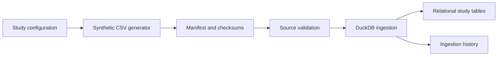

# Clinical Trial Data Quality & Validation Platform

A Python data pipeline for a synthetic multisite clinical study. It generates reproducible study records, validates the input files and loads them into a typed DuckDB database with source tracking and transactional imports.

The project focuses on a basic but important data-engineering problem: **how to load study data reliably, preserve its origin and detect structural problems before analysis.**

## What it does

- Generates a fictional 12-week study with four sites, 500 participants and four scheduled visits per participant by default.
- Produces six related CSV datasets: sites, participants, visits, vital signs, laboratory results and adverse events.
- Records file checksums and row counts in a SHA-256 manifest so a generated dataset can be verified before loading.
- Checks required columns, identifiers, data types, date formats and cross-table references.
- Loads records into DuckDB with explicit types, primary/foreign keys and all-or-nothing transactions.
- Tracks imported source files and reports successful, skipped and failed imports.
- Prevents duplicate ingestion of an identical source manifest, while allowing different generated datasets to coexist.

## Data flow



The input data is synthetic. Study groups, measurements and adverse events are simulated; they are not records from a clinical trial.

## Getting started

**Requirements:** Python 3.11+ and Git. The application runs locally on Windows, Linux or macOS. DuckDB is installed as a Python dependency; no database server or cloud account is needed.

From the project root, on Windows using **Git Bash**:

```bash
py -3.11 -m venv .venv
source .venv/Scripts/activate
python -m pip install -e '.[dev]'
```

Generate and verify the study data:

```bash
python -m clinical_trial.generate --output-dir data/generated
python -m clinical_trial.verify --input-dir data/generated
```

Load the dataset and inspect its ingestion history:

```bash
python -m clinical_trial.ingest --input-dir data/generated --db data/study.duckdb
python -m clinical_trial.ingest --db data/study.duckdb --status
```

Importing the same dataset again returns `SKIPPED` rather than creating duplicates:

```bash
python -m clinical_trial.ingest --input-dir data/generated --db data/study.duckdb
```

Generated CSV files and the local DuckDB database are ignored by Git. A small example dataset is available in [`data/example/`](data/example/).

## Study data

The default configuration is in [`configs/study_protocol.json`](configs/study_protocol.json). The generator creates the following records with its default seed:

| Dataset | Records |
| --- | ---: |
| Sites | 4 |
| Participants | 500 |
| Visits | 2,000 |
| Vital-sign measurements | 4,000 |
| Laboratory results | 8,000 |
| Adverse events | 49 |

The tables use dataset-scoped keys so separately generated datasets can be stored in the same database without mixing their records. Dates are stored as `DATE`, measured values as `DECIMAL(18,6)` and source file metadata in dedicated provenance tables.

See the [data dictionary](docs/data_dictionary.md) for fields and relationships, and [ingestion design](docs/ingestion.md) for the database contracts and failure behaviour.

## Testing

Run the unit and integration tests:

```bash
python -m pytest -q -rs
```

Run an isolated end-to-end smoke test:

```bash
python -m clinical_trial.smoke
```

The test suite covers deterministic generation, manifest integrity, source-data constraints, relational loading, duplicate imports and transaction rollback. The repository also includes a GitHub Actions workflow for running the tests and a sample ingestion sequence.

## Repository layout

```text
configs/                 Study configuration
data/example/             Small synthetic CSV sample
docs/                     Study protocol, data dictionary, ingestion design
src/clinical_trial/       Generator, source checks and DuckDB loader
tests/                    Unit and database integration tests
.github/workflows/        Automated checks
```

## Scope and limitations

The current pipeline validates **file integrity and structural consistency**, not the clinical plausibility of every observation. A value can be correctly formatted and still require clinical review. The simulated measurements are not medical reference ranges, and the software is not intended for clinical operations or regulatory submissions. The tables draw on familiar clinical-study concepts but are not CDISC SDTM-compliant datasets.

No real patient data is used or needed.

## Documentation

- [Synthetic study protocol](docs/study_protocol.md)
- [Data dictionary](docs/data_dictionary.md)
- [Database and ingestion design](docs/ingestion.md)
- [Architecture decisions](docs/decisions.md)

## License

[MIT](LICENSE)
