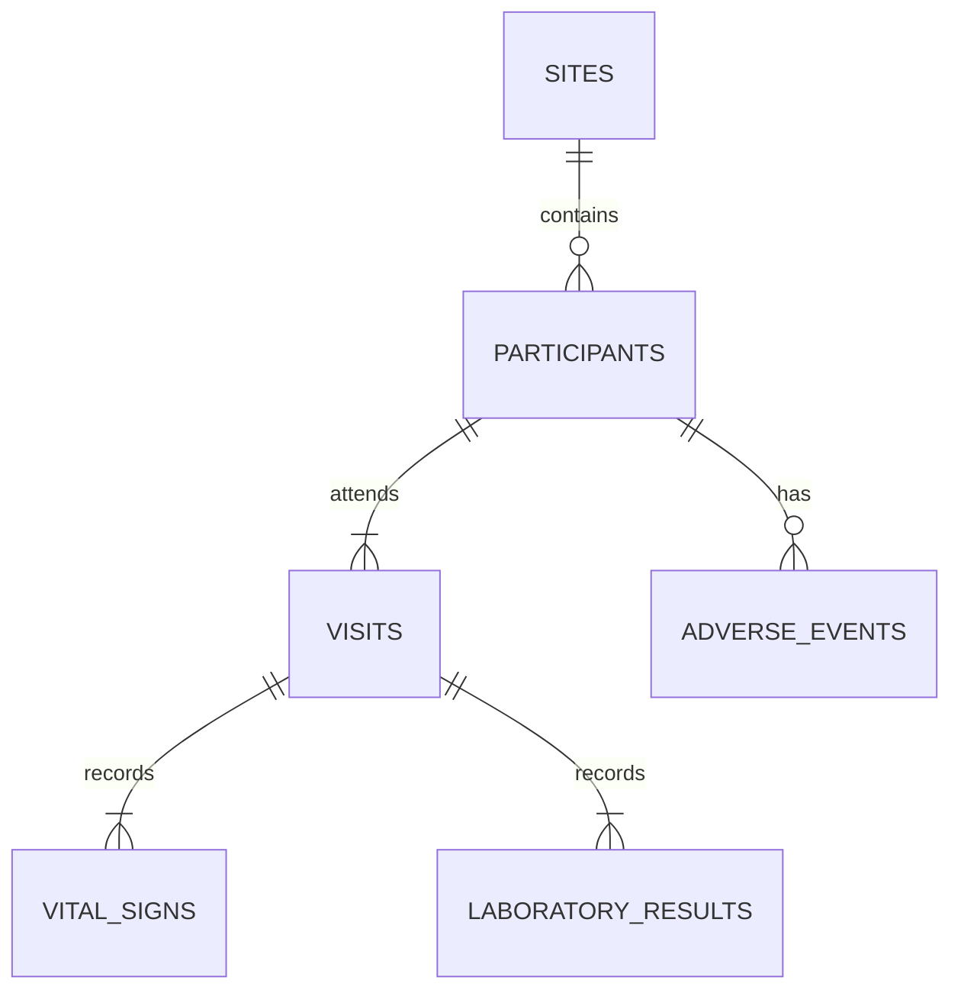

# Data dictionary

All identifiers below are **synthetic**, and tables are stored as UTF-8 CSV. Date columns use `YYYY-MM-DD`. Numeric values are serialized as strings in CSV and explicitly typed during DuckDB ingestion. The CSV schema is enforced by `src/clinical_trial/schema.py`.

## Relationships and grain

### `sites` — one row per fictional site

| Field | Type | Constraint |
|---|---|---|
| `site_id` | text | primary key, e.g. S01 |
| `site_name` | text | required; fictional only |

### `participants` — one row per participant

| Field | Type | Constraint |
|---|---|---|
| `participant_id` | text | primary key, e.g. P000001 |
| `site_id` | text | required; references sites.site_id |
| `study_group` | text | ARM_A or ARM_B, arbitrary labels |
| `age_years` | integer | generated ages 18–80 |
| `recorded_sex` | text | F / M / U in this simplified fictional source |
| `enrollment_date` | ISO date | required |

### `visits` — one row per participant and scheduled visit

| Field | Type | Constraint |
|---|---|---|
| `visit_id` | text | primary key |
| `participant_id` | text | references participants.participant_id |
| `visit_code` | text | BASELINE / WEEK04 / WEEK08 / WEEK12 |
| `planned_date` | ISO date | enrollment date + protocol day |
| `actual_date` | ISO date | within fictional protocol window in clean baseline |

Unique business key: (`participant_id`, `visit_code`). This business key is an assumption of the clean synthetic dataset.

### `vital_signs` — one row per visit and measurement type

| Field | Type | Constraint |
|---|---|---|
| `measurement_id` | text | primary key |
| `visit_id` | text | references visits.visit_id |
| `test_code` | text | SBP / HR |
| `result_value` | decimal | synthetic reading |
| `unit` | text | mmHg for SBP; beats/min for HR |

Unique clean-data business key: (`visit_id`, `test_code`).

### `laboratory_results` — one row per visit and laboratory test

| Field | Type | Constraint |
|---|---|---|
| `measurement_id` | text | primary key |
| `visit_id` | text | references visits.visit_id |
| `test_code` | text | HGB / GLU / CREAT / SOD |
| `result_value` | decimal | synthetic reading |
| `unit` | text | g/dL / mg/dL / mg/dL / mmol/L respectively |

Unique clean-data business key: (`visit_id`, `test_code`).

### `adverse_events` — zero or more events per participant

| Field | Type | Constraint |
|---|---|---|
| `event_id` | text | primary key |
| `participant_id` | text | references participants.participant_id |
| `event_term` | text | HEADACHE / FATIGUE / NAUSEA / DIZZINESS |
| `severity` | text | MILD / MODERATE; simulated only |
| `start_date` | ISO date | on/after enrollment |
| `end_date` | optional ISO date | empty for simulated ongoing events; otherwise on/after start |

## Ingestion metadata tables

- `datasets`: source manifest hash, study ID, source directory and ingestion timestamp.
- `source_files`: source filename, content checksum and expected row count.
- `ingestion_events`: successful, skipped and failed ingestion attempts.

All loaded study tables include `dataset_id` to isolate different synthetic generations.
