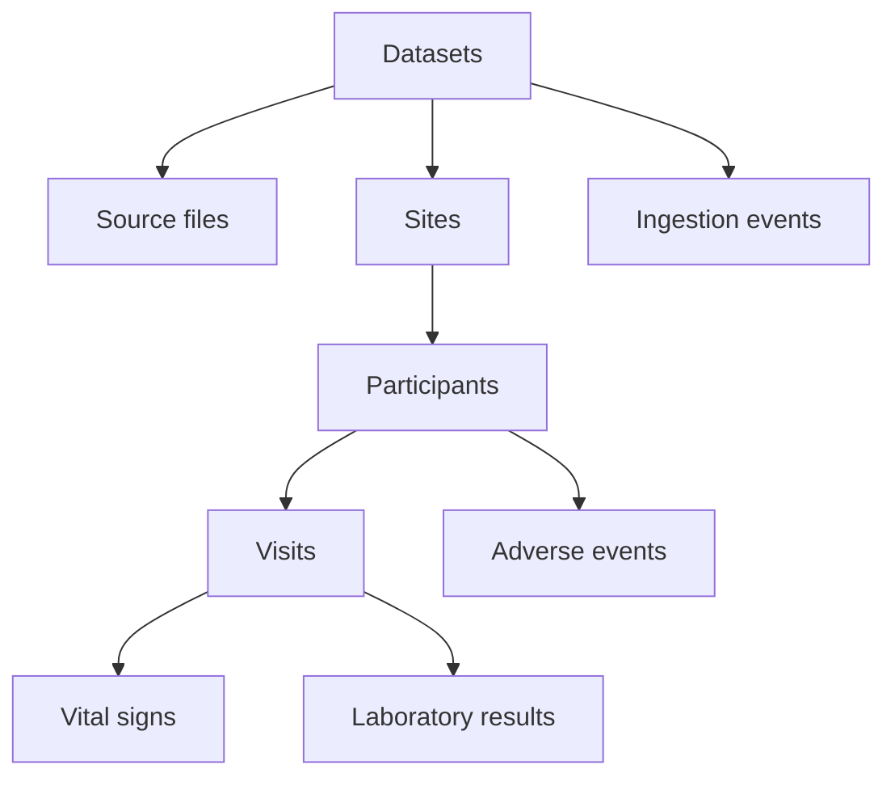

# Phase 2 — transactional DuckDB ingestion

## Guarantees and scope

- A six-file dataset must pass `verify_manifest()` (presence, expected headers, manifest row counts, per-file SHA-256) and a **structural preflight** (nonempty required fields, ISO dates, valid integer/decimal strings, unique primary IDs, and foreign-key references).
- Structural preflight is not clinical review. Physically unusual values are deliberately preserved for a *future* Phase 3 rules engine; this phase does not identify suspected protocol deviations.
- The entire batch is ingested in one transaction. If any SQL conversion, foreign-key, or row-count reconciliation fails, the batch is rolled back and a `FAILED` event is recorded afterwards.
- Ingesting the identical manifest a second time records a `SKIPPED` event; it does not add duplicate measurements.
- Different manifests (e.g. different seeds) get distinct dataset IDs, so identical participant identifiers can coexist in separate batches.
- `source_files` stores each input filename, SHA-256 and source row count; `datasets` stores the exact manifest checksum, study ID and source directory. All six typed tables contain `dataset_id` so any record can be traced to its source file using its table name.
- The study generator and database contain **fictional patients only**. It is not an EDC platform or a regulated clinical data system.

## Data types

| Field | Type | Rationale |
| --- | --- | --- |
| IDs, code fields | VARCHAR | Preserve leading zeros and fixed reference labels |
| Enrolment, visit and AE dates | DATE | Explicit ISO YYYY-MM-DD parsing |
| Age | INTEGER | Fail malformed integer strings |
| Vital and lab values | DECIMAL(18,6) | Represent generated values without binary floating-point rounding; reject source values with more than six decimal places |
| Source row counts | BIGINT | Counts reconcile to manifest |
| Ingestion event timestamp | TIMESTAMPTZ | DuckDB-managed timestamp, not necessarily same as synthetic study dates |

## Ingestion order

1. `sites` (parent)
2. `participants` (references sites)
3. `visits` (references participants)
4. `vital_signs` / `laboratory_results` (reference visits)
5. `adverse_events` (reference participants)

A batch uses a SHA-256 hash of the exact `manifest.json` bytes as its identifier. The manifest already contains source file SHA-256 hashes. Content is verified before loading. Modifying data requires regenerating or explicitly rebuilding the manifest and will create a distinct batch.

## Data-model diagram



**Note:** Each stored parent/child relation is scoped to `dataset_id`, so separate generated batches do not mix records. Ingestion events contain the batch identifier but intentionally do not enforce a foreign key to `datasets`, enabling failures to be logged even when no dataset is committed.

## Command line

```powershell
.\.venv\Scripts\python.exe -m clinical_trial.generate --output-dir data/generated
.\.venv\Scripts\python.exe -m clinical_trial.verify --input-dir data/generated
.\.venv\Scripts\python.exe -m clinical_trial.ingest --input-dir data/generated --db data/study.duckdb
.\.venv\Scripts\python.exe -m clinical_trial.ingest --db data/study.duckdb --status
.\.venv\Scripts\python.exe -m clinical_trial.smoke
.\.venv\Scripts\python.exe -m pytest -q
```

Running `ingest` twice should report `LOADED` then `SKIPPED` for the *same* manifest. The `--status` command lists batches, counts and ingestion events. A failed preflight or import returns a nonzero exit code.

## Remaining caveats

- The Phase 2 schema uses simplified names, not CDISC SDTM compliance or a production clinical data model.
- The source manifest is a tamper-detection aid, **not a cryptographic signature of authenticity**; anyone who controls the sources can rewrite hashes.
- This is a local single-writer demonstration, not a concurrent hosted data warehouse.
- Nothing is quarantined and automatically corrected. Phase 2 rejects a bad batch atomically and stores an error event; row-level issues and triage will be introduced in Phases 3 and 6.
- Data validation rules such as visit-window checks, expected units or physiological ranges are deliberately not evaluated here.
- The integration tests require a working `duckdb` installation. Without it, pytest skips that module and passes the source validation/unit tests only.
